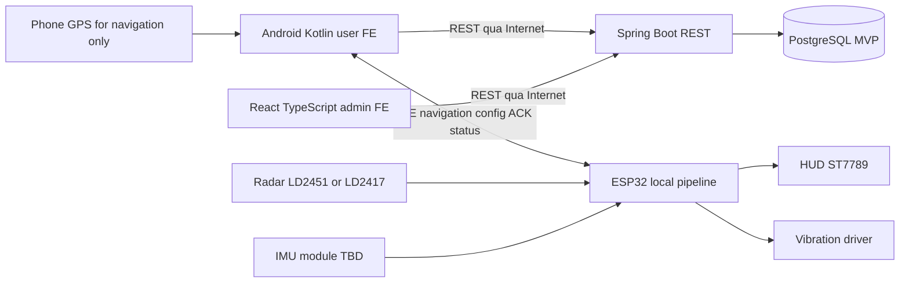

# Kiến trúc RideGuard — implemented foundation / proposed MVP

Monorepo và đường dẫn thực tế giữ nguyên. Implemented: health/security/error nền tảng,
FE foundation, firmware startup/stubs, Python session split; không có nghiệp vụ hoặc ML
đã chạy. [Implemented API](../../contracts/openapi.yaml),
[proposed MVP](../../contracts/openapi.proposed.yaml), [deferred](../roadmap.md).

Backend không gọi REST trên điện thoại; mobile chủ động gọi backend. Radar+IMU → temporal
features/tracking → risk → HUD/rung trên ESP32; không gửi radar cloud chờ quyết định. Mất
Internet/login hết hạn không dừng core warning. Missing/stale/fault phải UNKNOWN/UNAVAILABLE,
không SAFE. IMU không biết trước ý định rẽ. GPS còn phục vụ navigation, không lưu/đồng bộ
hành trình trong MVP và không là tín hiệu chính kích hoạt cảnh báo đổi hướng.

## Trách nhiệm theo đường dẫn thật

- apps/mobile: Kotlin/Compose user FE; future features auth/devices/navigation/settings/
  feedback; shared networking/BLE/storage/models/UI tách adapter. Hiện có foundation
  navigation và API URL; Room trip queue không thuộc MVP.
- apps/admin-web: React/TypeScript admin FE; future auth/users/devices/feedback; backend
  phải kiểm ADMIN, không chỉ ẩn nút. Không dashboard số liệu giả hoặc trang vị trí.
- apps/backend: Spring Boot com.rideguard future auth/users/devices/feedback/shared;
  devices gồm bindings/config/reports. Chỉ shared + health hiện có, không tạo lớp rỗng.
- firmware: drivers/radar có chọn LD2451/LD2417 tại build, stubs NotImplemented. Planned
  drivers/imu/display/vibration, tracking/features/risk/navigation/communication/ui/power/
  diagnostics; không tạo thư mục rỗng hoặc kích GPIO chưa xác nhận.
- ai: offline preprocessing/features/training/evaluation/export; baseline và ML nhẹ
  dùng radar+IMU kết hợp theo thời gian/từng mục tiêu, không hai mô hình rời thiếu fusion.
  Chưa train/độ chính xác/inference REST. Chi tiết [AI README](../../ai/README.md).
- contracts: một OpenAPI implemented, một proposed, BLE riêng, JSON schemas. hardware
  giữ quyết định phần cứng; infra chỉ local PostgreSQL; tools thu log/replay/BLE khi thật
  sự triển khai; docs nguồn thiết kế và trạng thái, scripts kiểm hợp đồng offline.

## Dữ liệu và ranh giới

MVP giữ tài khoản/session, USER/ADMIN, serial binding/history, config mỗi ownership,
mobile status reports, feedback/admin. DB proposed 7 nghiệp vụ+3 kỹ thuật; V1 implemented
chỉ schema. Config desired≠applied; ACK mobile không hardware proof. Reports không online
realtime. Lịch sử liên kết vẫn MVP dù lịch sử hành trình deferred. Device registry status
không là lệnh tắt ESP32. Không OTA/payment/sharing/possession challenge trong MVP.

NodeMCU-32S, ST7789 240×240, motor qua driver, pin tháo rời sạc ngoài. Radar chỉ một driver
mỗi build, IMU LSM6DS3/BMI160 chưa chốt, chưa pinout/nguồn/mount. Không đoán protocol,
radar xuyên lớp phản xạ gương hoặc radar target ID ổn định. LD2417 axis Y không tự đồng
nhất distance LD2451; missing fields null, giữ sensor/units/distance definition/clock.

Nguy cơ đổi hướng và bị áp sát phía sau khi đi thẳng là hai tình huống khác nhau; cần
phê duyệt policy từng loại. Cùng phía mục tiêu/ego movement chưa đủ kết luận giao cắt.
Không coi policy/ML/cảm biến đã triển khai. Artifacts từng thành phần độc lập; không
thêm inference server hay deploy pipeline. Cập nhật tài liệu không yêu cầu bật stack.
