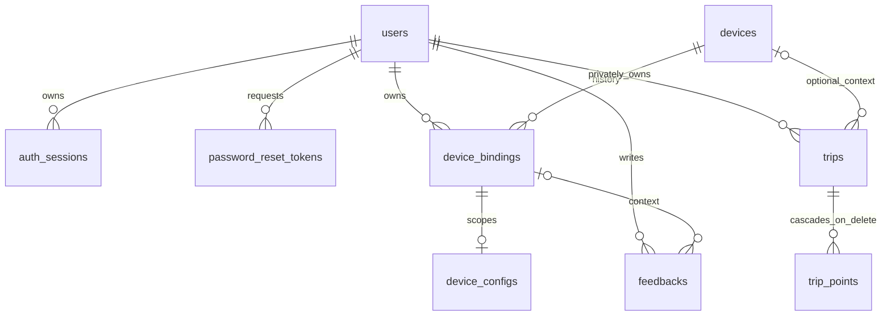

# Proposed ERD

This diagram describes the design in [schema.md](schema.md), not installed tables.

Only one active binding per device via partial unique index. Trip ownership does not
move with device ownership. Config belongs to binding, never directly to device.
