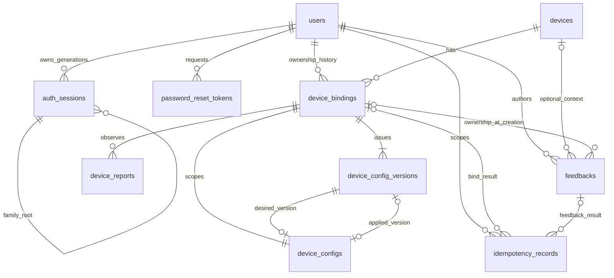

# ERD MVP — proposed

[Schema chi tiết](schema.md): 7 bảng nghiệp vụ và 3 kỹ thuật, chưa có migration nghiệp vụ.

devices/configs/feedbacks không chứa ownership user override từ client. Một active binding
mỗi device qua partial unique; config/report theo binding, không chuyển dữ liệu chủ cũ.
auth_sessions là generations, API sessions dedup family. idempotency_records target đúng
một loại khi hoàn tất; ERD optional edges không thay CHECK XOR. Hai config FK là composite
(binding_id,version), chỉ applied nullable. Không có hành trình/proof tables trong MVP.
